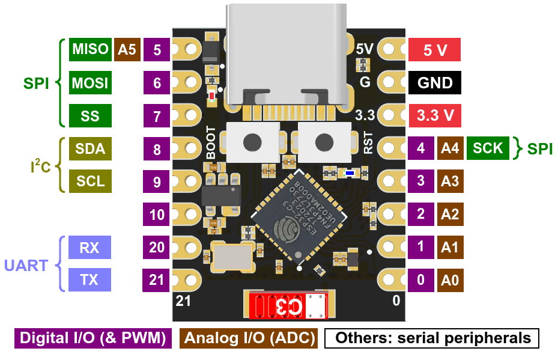

# Project Structure and Drivers

This document describes the ESP-IDF application structure and the GPIO assignments for the ESP32-C3 SuperMini.



## High-level structure

```text
esp_IoT/
├── CMakeLists.txt                 # Project build setup and component search paths
├── dependencies.lock              # Resolved ESP-IDF component versions
├── sdkconfig                      # ESP-IDF project configuration
├── main/
│   ├── main.c                     # Application startup and FreeRTOS tasks
│   ├── CMakeLists.txt             # Registers main.c and its driver dependencies
│   └── idf_component.yml          # Managed component requirements
├── drivers/                       # Project-specific hardware drivers
│   ├── board_config/              # Shared ESP32-C3 SuperMini GPIO assignments
│   ├── bmp180/
│   ├── buzzer/
│   ├── ir_nec/
│   ├── oled_display/
│   ├── rgb_led/
│   └── st7735_display/
├── esp-idf-lib/                   # External esp-idf-lib components (including DHT)
├── managed_components/            # Components downloaded from the ESP Component Registry
└── build/                         # Generated build output; not application source
```

Peripheral drivers use this layout; `board_config` is a header-only component:

```text
drivers/<driver>/
├── CMakeLists.txt
├── inc/                           # Public headers included by other components
└── src/                           # Driver implementation
```

## Application flow

`main/main.c` coordinates the active peripherals:

1. Initializes the ST7735 TFT using the SPI pins in the board map.
2. Reads the light sensor's analog output on GPIO 0 and soil sensor's analog output on GPIO 1 (both ADC1), averages eight samples per sensor, and updates the display every 1,000 ms. Light is converted to estimated lux using a three-point piecewise linear calibration; soil ADC counts are provisionally scaled linearly from 0-4095 to 0-100%.
3. Reads the DHT11 on GPIO 20 every 2,000 ms and displays temperature/humidity or a sensor error alongside the light and soil readings.

The BMP180, OLED, NEC transceiver, buzzer, and RGB LED drivers are not started by this board configuration; their previous pin assignments are not used.

## Local drivers

| Driver | Location | What it does | GPIO / interface |
|---|---|---|---|
| **Board GPIO map** | `drivers/board_config/inc/board_pins.h` | Central pin assignments for the ESP32-C3 SuperMini wiring. | GPIO assignments are listed below. |
| **DHT11** | External `esp-idf-lib/components/dht` component | Reads temperature and humidity. | Single-wire data: GPIO 20. |
| **ST7735 display** | `drivers/st7735_display/` | Displays DHT11, soil moisture, and light readings with bitmap sensor icons; the header contains a leaf, fan, sprinkler, and lamp. Actuator icons are visual previews and are not connected to actuator state yet; the MQTT status indicator and label remain red/`OFFLINE` until connectivity is implemented. | TFT `RESET` GPIO 3, `A0` GPIO 8, `CS` GPIO 7, `SDA` GPIO 6, `SCK` GPIO 4. TFT `LED` backlight is not assigned to an MCU GPIO. |
| **Soil sensor** | `main/main.c` | Averages eight ADC samples and provisionally maps the ADC range 0-4095 to 0-100%; sensor-specific dry/wet calibration is pending. | Analog output (`AO`/`AOUT`): GPIO 1, ADC1. |
| **Light sensor** | `main/main.c` | Averages eight ADC samples and estimates lux using piecewise linear interpolation across three calibration points. | Analog output (`AO`/`AOUT`) on GPIO 0, ADC1. |
| **Fan** | Pin reserved in board map | PWM output assignment; fan control is not implemented. | PWM: GPIO 5. |
| **Light** | Pin reserved in board map | PWM output assignment; light control is not implemented. | PWM: GPIO 10. |
| **UART console** | ESP-IDF UART0 | Serial monitor and flashing console. | TX GPIO 21. RX GPIO 20 is shared with DHT11 after application startup. |
| **Pump** | Not assigned in this UART-console configuration | GPIO 21 is occupied by UART0 TX; choose a different safe pin before enabling pump control. | No pump GPIO assigned. |

The managed `waveshare/esp_lcd_st7735` component provides the TFT driver. The DHT implementation and helper components are supplied by `esp-idf-lib`. The project `sdkconfig` already targets `esp32c3`.

## ESP32-C3 SuperMini connections

The diagram follows the physical pin order in the image above (USB-C at the
top, viewed from the component side). <span style="color: green">Green means
free</span> and <span style="color: red">red means assigned/used</span>.

<pre>
                                USB-C
                           +------------+
<span style="color: red">GPIO5  Fan PWM</span>  -----------|            |----------- (power) 5V
<span style="color: red">GPIO6  TFT SDA</span> ------------|            |----------- (power) GND
<span style="color: red">GPIO7  TFT CS</span>  ------------| ESP32-C3   |----------- (power) 3.3V
<span style="color: red">GPIO8  TFT A0</span>  ------------| SuperMini  |----------- <span style="color: red">GPIO4  TFT SCK</span>
<span style="color: green">GPIO9  FREE</span>     -----------|            |----------- <span style="color: red">GPIO3  TFT RESET</span>
<span style="color: red">GPIO10 Light PWM</span>-----------|            |----------- <span style="color: green">GPIO2  FREE</span>
<span style="color: red">GPIO20 DHT11 / UART0 RX</span>    |            |----------- <span style="color: red">GPIO1  Soil ADC</span>
<span style="color: red">GPIO21 UART0 TX</span> -----------|            |----------- <span style="color: red">GPIO0  Light ADC</span>
                           +------------+
</pre>

GPIO 8 is connected to the TFT's `A0` pin; GPIO 9 remains free, and GPIO 10
is used for light PWM. On the board pinout, GPIO 8/9 also have alternate I2C
labels SDA/SCL, but those alternate functions are not used here. Note that
the TFT connector's `SDA` pin is a separate signal connected to GPIO 6 and is
SPI data, not I2C. GPIO 8 is a strapping pin, so make sure the TFT `A0` input
does not pull it low during reset.

GPIO 20 is the DHT11 data pin and UART0 RX. The application reconfigures
GPIO 20 for the DHT11 after startup, so UART0 input/console commands are not
available while the sensor task is active; serial output remains on GPIO 21.
GPIO 21 remains reserved for UART0 TX, so it is not assigned to the pump.
Connect the light module's analog output (`AO`/`AOUT`) to GPIO 0 and the soil
sensor's analog output (`AO`/`AOUT`) to GPIO 1. Use a
shared ground, and ensure neither sensor's output exceeds 3.3 V. Lux is currently
estimated with piecewise linear interpolation from three phone-meter
comparisons: 9 lux at ADC 2878, 24 lux at ADC 2335.5, and 62 lux at ADC
1558.6 (average of nine samples, ranging from 1483 to 1611). The latest
high-light measurement replaces the earlier inconsistent 61-lux point. This
is an approximate, module-specific calibration, not a traceable
lux measurement; LDR response is nonlinear, so collect additional reference
points or use a calibrated digital lux sensor for reliable readings. Values
outside the measured range are extrapolated using the nearest segment.

### TFT wiring by the labels on its connector

Use the actual labels printed on the TFT. `SDA` is the TFT's SPI data input;
the display driver calls that signal MOSI internally. Likewise, the TFT's
`A0` pin is the data/command select signal called DC in the driver. Neither
label means this display is connected over I2C.

| TFT pin label | Connect to C3 | Meaning in the project |
|---|---:|---|
| `SCK` | GPIO 4 | SPI clock (`LCD_GPIO_SCLK`) |
| `SDA` | GPIO 6 | SPI data to TFT / MOSI (`LCD_GPIO_MOSI`) |
| `A0` | GPIO 8 | Data/command select / DC (`LCD_GPIO_DC`) |
| `RESET` | GPIO 3 | Display reset (`LCD_GPIO_RST`) |
| `CS` | GPIO 7 | SPI chip select (`LCD_GPIO_CS`) |
| `LED` | 3.3 V supply, if supported by the TFT module | Backlight power; not an MCU GPIO |

This table intentionally omits the TFT's power pins (`GND` and `VCC`).
**Important:** the TFT's `LED` pin is currently disconnected, so the
backlight stays off even though the firmware initializes the display. Connect
`LED` to the backlight supply specified for your TFT module (commonly 3.3 V
for a 3.3 V breakout). Do not connect it to an ESP32 GPIO, and do not use 5 V
unless the module documentation explicitly allows it. Check whether the
module includes a backlight current-limiting resistor before wiring it.

## Pin and voltage notes

- GPIO 2 and GPIO 9 are free; GPIO 9 is not used for its alternate SCL function.
- GPIO 8 is assigned to the TFT's `A0` pin (data/command select), not I2C SDA; keep it from being pulled low during reset. GPIO 10 is assigned to light PWM.
- Use the board's 3.3 V logic for GPIO signals. The 5 V and GND connections shown are power connections, not GPIO signals.
- The TFT `LED` backlight requires a separate supply; follow the TFT module's voltage and current-limiting requirements.
- Do not drive the fan, pump, or lamp directly from an ESP32 GPIO; use a suitable power driver and a shared ground.
- Soil moisture percentage currently maps ADC 0 to 0% and ADC 4095 to 100%. This is a provisional full-scale mapping, not a calibrated moisture measurement; replace it with dry/wet sensor readings before relying on the percentage, since module output direction and useful range vary. Fan/light/pump control are not implemented yet; their GPIO assignments are centralized for future use.
